<div align="center">



<a href="https://git.io/typing-svg"></a>

<br/>

`full-stack` · `systems-minded` · `open-source` · `iiit sonepat '29`

</div>


### 👾 hey, i'm shivanshu

i build stuff, break it, then figure out why it worked.
architecture, system design and distributed systems are my happy place.
the unglamorous parts that never show up in a demo? yeah, i love those.

```bash
~/shivanshu $ neofetch

  role        →  full stack engineer / system builder
  intern @    →  hashedtoken
  studying    →  b.tech cs, iiit sonepat"29
  open source →  Vlab-iiit-sonepat
  vibe        →  shipping > talking
  fuel        →  chai + stubbornness ☕
```


### 🚀 things i shipped

<table>
<tr>
<td width="50%" valign="top">

#### 🔍 [RealityLens](https://realitylens.in)
"is this even true?" in one click. an AI misinformation detector that scores posts for credibility in real time.

`Electron` `FastAPI` `React`

</td>
<td width="50%" valign="top">

#### 💬 [ChitGit](https://chit-git.vercel.app/)
chat with any github repo in plain english. RAG does the heavy lifting, you just ask.

`FastAPI` `Qdrant` `Redis` `TypeScript`

</td>
</tr>
<tr>
<td width="50%" valign="top">

#### 📚 [PYQHub](https://pyqhub-2-0.vercel.app/)
real students at IIIT Sonepat use this to grab previous year papers. real users, real exam-week traffic.

`Prisma` `PostgreSQL` `CI/CD`

</td>
<td width="50%" valign="top">

#### 🧠 Redis, but i built it
a Redis clone from scratch in Go, evolving into a Raft-based distributed KV store. consensus, but make it chaos.

`Go` `Raft` `Distributed Systems`

</td>
</tr>
</table>


### 🧰 toolbox

<p align="center">

</p>


### 🧬 how i roll

```diff
+ ship first, polish loudly
+ understand it or don't merge it
+ systems over spaghetti
+ open source is home
- tutorial hell
- code i can't explain
```


### 📊 the receipts

<p align="center">

</p>

<p align="center">

</p>


### 📬 say hi

got a wild idea or a gnarly backend problem? let's talk.

<p align="center">
<a href="https://www.linkedin.com/in/shivanshu-mangal-8a601b378/"></a>
<a href="https://portfolio-orpin-delta-mn8ung4k67.vercel.app/"></a>
<a href="https://github.com/shivanshumangal007-dev"></a>
</p>

<div align="center">


<sub>built with intent · shipped with caffeine ☕</sub>

</div>
